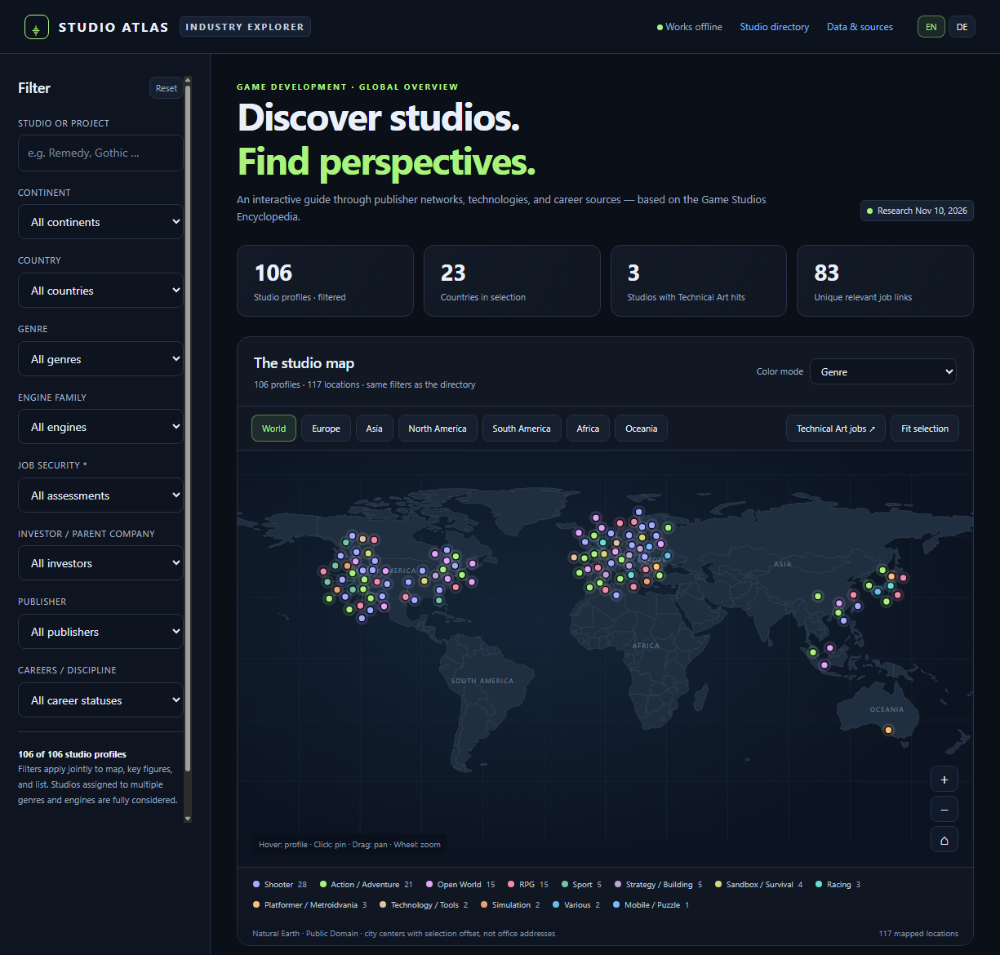

# Game Studio Map

An interactive, offline-capable atlas of the world's major game studios. The
English Markdown encyclopedia [game_studios_enzyklop_die.md](game_studios_enzyklop_die.md)
is compiled into a self-contained HTML page ([index.html](index.html))
— with a world map, filter panel, studio profiles, researched job listings, and
Steam artwork, all without a server or external runtime resources.

<p style="text-align:center"></p>

## Report contents

- **105 studio profiles** across 20+ publisher groups (PlayStation, Xbox, EA,
  Ubisoft, Embracer, THQ Nordic, Tencent, Rockstar, Take-Two, Nintendo, Valve,
  CD Projekt Red, Larian, Kojima, Remedy, and many more) plus indie studios
- **116 locations** with coordinates, country flags, and an interactive world
  map (Natural Earth data, zoomable and pannable)
- Per studio: engine, current project, franchise, genre, publisher,
  investor/parent company, and an assessment of future outlook & layoffs
- **Career research:** open positions from public job portals (Greenhouse,
  Lever, SmartRecruiters, Jobylon, careers pages), categorized across engineering,
  design, art, production, QA, marketing, operations, and other studio roles
- Filters by group, continent, engine, genre, investor, and stability
- Map/List tabs share the same filters. Continent buttons below the statistic cards filter
  both views; the top
  Studio directory link opens the List tab. Tabs support
  Left/Right arrow keys and Home/End. Opening or reloading the page always
  selects Map, including when the URL retains an old List fragment.
- The AI provenance notice is a darker, right-aligned second row inside the header and stays
  visible in both views. Continent buttons sit right-aligned beside the tabs.
- The map toolbar puts Fit selection and Color mode on one row, without a
  separate map heading.
- The List panel matches the Map panel's flush, square top corners and compact
  toolbar: Expand all and the profile count on the left, Sort by on the right.
- The larger shared Career dropdown is centered above the statistic cards.
  Continent buttons remain below the cards. Career filters both views and stays
  synchronized with the sidebar.
- Career disciplines are sorted alphabetically by their displayed EN/DE labels;
  All remains the first option.
- All six continent filters remain selectable even without dataset coverage.
  Continents without matching studios show empty map/list results, not World results.
- **Language switch (EN/DE)** in the top bar; the UI language is persisted in
  `localStorage`. Studio profile data itself is in English (the source
  document's language)

## Quick start

Open the finished report by double-clicking `index.html`.

Every build mode and both update workflows generate `index.html` in the project
root. To publish it at https://michagrandel.github.io/game-studio-map/, push the
generated file and enable GitHub Pages under **Settings → Pages**, selecting
**Deploy from a branch**, your publishing branch, and **/ (root)**.
GitHub Pages serves the generated file; it does not refresh the dataset.

## Project structure

| File | Purpose |
|---|---|
| `game_studios_enzyklop_die.md` | Source data: Obsidian-style Markdown with one `###` profile, a data-collected date, and 8 fields per studio |
| `studio-resources.mjs` | Editorial resources: websites, career links, LinkedIn slugs, job boards, city coordinates, location overrides, Steam app IDs |
| `career-categories.mjs` | Shared career taxonomy and title-based classification for public job listings |
| `build-report.mjs` | Build script: parses the source, researches job listings, downloads map/flags/artwork, and generates the report |
| `update-all.mjs` | One-command non-AI evidence collection, full career/asset refresh, report rebuild and tests |
| `studio-research.mjs` | Bounded official-site crawler and unverified evidence extraction for all eight studio fields |
| `studio-research.json` | Generated studio-evidence cache, with per-field gaps and explicit source errors |
| `.github/prompts/update-game-studio-map.prompt.md` | AI-assisted complete research command for VS Code Copilot Chat |
| `report-template.html` | HTML template (dark mode, EN/DE switch); the data is injected into the `/*__REPORT_DATA__*/` placeholder |
| `report-data.json` | Cache of the research results (jobs, map, flags, artwork) |
| `index.html` | Generated, self-contained report and GitHub Pages entry point — open directly in a browser |
| `report.test.mjs` | Tests (node:test) validating the report's fidelity to the source, coordinates, and links |
| `studios.md` | Original task brief for the encyclopedia (German) |
| `.agents/skills/update-studio-atlas/` | Agent skill guiding the data-maintenance workflow (see below) |

## Requirements

- Node.js ≥ 18 (ESM, top-level await, `fetch`)
- No npm dependencies — no `npm install` needed
- Network access only for the refresh step (job portals, Natural Earth,
  flagcdn.com, Steam artwork)

## Rebuild and Tests

### One-command updates

**Without AI (PowerShell):**

```powershell
node update-all.mjs
```

Attempts every profile and all eight studio fields using each official homepage
and up to four linked about/company/games/news pages. Collects short evidence
excerpts and URLs in `studio-research.json`, refreshes all career listings and
assets, rebuilds the report's **Last updated** date, then runs the tests.
The command can also be launched from another directory using its absolute path.

This is best-effort collection, **not complete factual verification**. Existing
Markdown facts and studio collection dates are preserved: text matches can refer
to older announcements or the parent company rather than a specific studio.
Per-field evidence, missing evidence and source errors appear in each profile's
expandable evidence panel. Dynamic/protected job portals remain explicitly
incomplete. A successful command means the collection/build/tests ran, not that
all sources were accessible.

**AI-assisted full research (VS Code Copilot Chat, Agent mode):**

```text
/update-game-studio-map
```

Uses your active Copilot model and available web tools, with their normal
permissions/usage limits. No separate AI CLI or API key is required. If the
command is not listed yet, use **Chat: Run Prompt...** and select
`update-game-studio-map`, or open its prompt file and click Run.

The prompt researches every profile and all eight fields, updates the Markdown
facts and dates with citations and explicit unknowns, reviews career options,
then executes the non-AI full refresh and validation. It stops rather than
claiming a complete research run if web research is unavailable. Human review
is still recommended; neither AI nor scraping can guarantee unavailable facts.

For evidence collection only (no career refresh, report build or date change):

```powershell
node update-all.mjs --collect-only
```

### Development builds

Rebuild the report from the cache (fast, offline):

```powershell
node build-report.mjs
```

Rebuild after text-only changes to the source (re-parses profiles, keeps the
cached job research — no network needed):

```powershell
node build-report.mjs --reparse
```

After researching studio facts in the Markdown source, refresh job listings,
map, flags, and artwork (takes a few minutes, requires network). The build
script does not research studio facts automatically:

```powershell
node build-report.mjs --refresh
```

Run the tests:

```powershell
node --test
```

## Maintaining the data

BioWare is excluded by editorial request, regardless of its operating status.
Both studio source parsers reject its reintroduction, including site-name
variants. Do not add it during automated or AI-assisted maintenance.

> **Tip for agent users:** this repository ships the agent skill
> [`update-studio-atlas`](.agents/skills/update-studio-atlas/SKILL.md)
> (`.agents/skills/`). It guides an AI agent through the whole maintenance
> workflow — profile format, resource registration, rebuild mode selection,
> and validation. Invoke it as `/update-studio-atlas` or just ask to add or
> update a studio; the skill loads automatically.

- **New studio / changed data:** edit the profile in
  `game_studios_enzyklop_die.md` (maintain all 8 fields: Location, Engine,
  Current Project, Franchise, Genre, Publisher, Investor/Parent Company,
  Future Outlook & Layoffs). Set or update the profile's `Data collected` date
  to the day its information is researched or verified; do not change it for
  formatting-only edits. Existing profiles carry a 2026-11-11 baseline date,
  which does not imply they were all re-verified that day. Add a `resources`
  entry with website, careers
  link, and LinkedIn slug in `studio-resources.mjs`, and register new cities
  in `cities` with coordinates.
- **Every data-maintenance run:** research and review all studio profiles,
  update supported studio facts and their collection dates, review career
  categories, then run `node build-report.mjs --refresh` to refresh careers
  for all studios. Report incomplete or inaccessible sources; never advance
  a profile date without researching it. Cache-only builds and `--reparse`
  are development utilities, not substitutes for this maintenance workflow.
- Prefer `/update-game-studio-map` for AI-assisted all-profile research, or
  `node update-all.mjs` for explicitly partial non-AI evidence collection.
  Keep `> **Research sources:**` (raw HTTPS URLs with publication dates) and
  `> **Review note:**` blockquotes below the eight source fields after research;
  these are displayed in profile details. Do not edit `studio-research.json`
  by hand; rerun the collector.
- Career categories and their title-matching rules live in
  `career-categories.mjs`. If category matching changes, run `--refresh` so
  cached listings for every studio are reclassified from their source portals.
- **Source/cache mismatch:** the build script detects divergence between
  source and cache and asks for `--reparse` or `--refresh`.
- Studios with multiple sites are listed as one profile per site; deviations
  from the default location detection are controlled via `locationOverrides`.
- The header shows a localized month name (e.g. `Last updated: 12 November 2026`)
  from the successful report build
  timestamp (`updatedAt`). It does not imply all facts were newly verified.
  Career research retains its own timestamps, separate from studio collection
  dates.
- Click or keyboard-activate a legend entry to hide/show its pins. Hidden
  categories are retained separately per color mode; Reset shows all categories.
  Legend visibility affects the map only, not directory rows or statistic cards.
